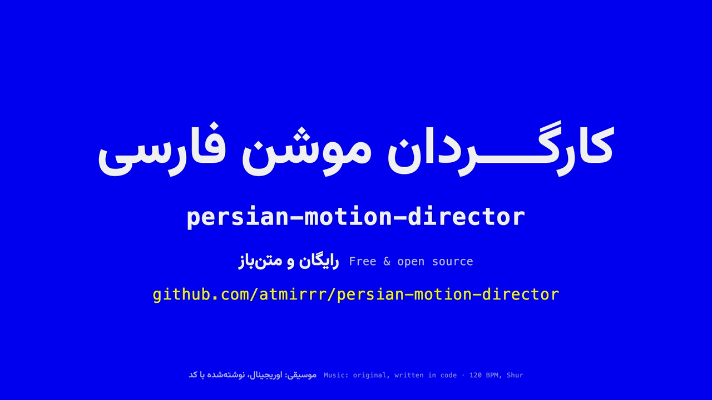
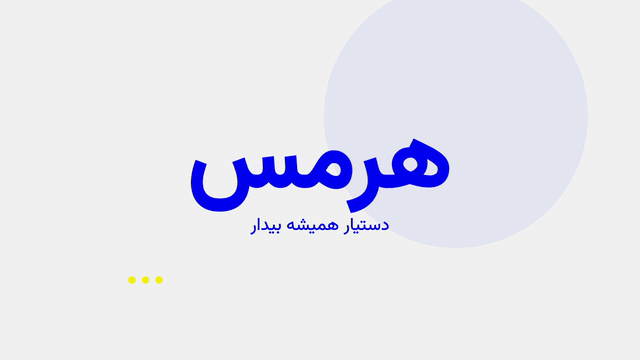
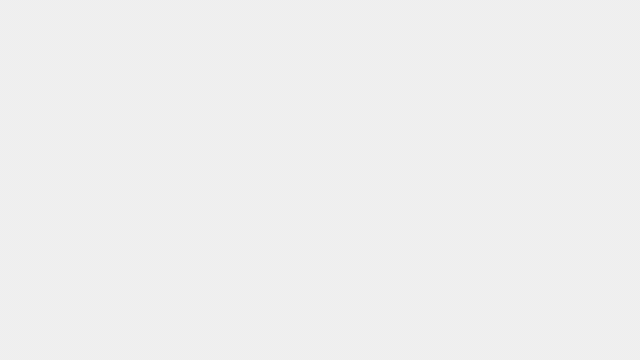
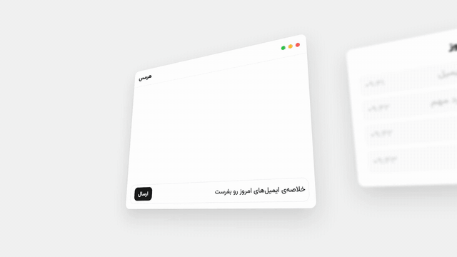
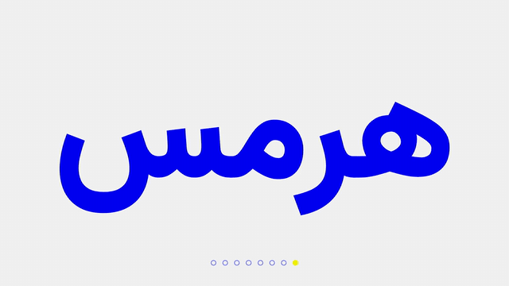
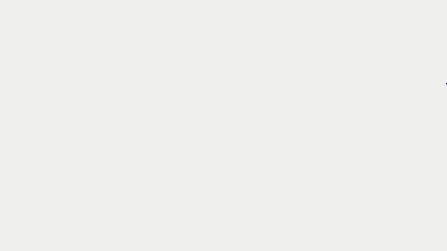
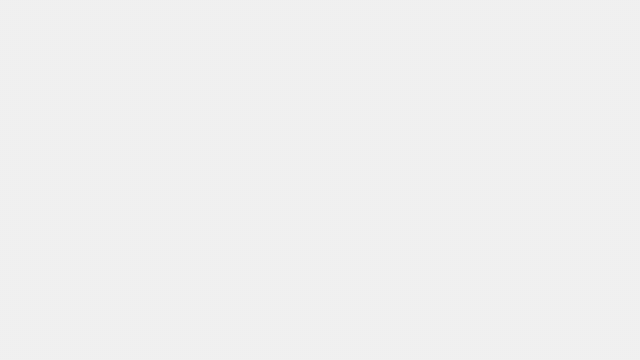
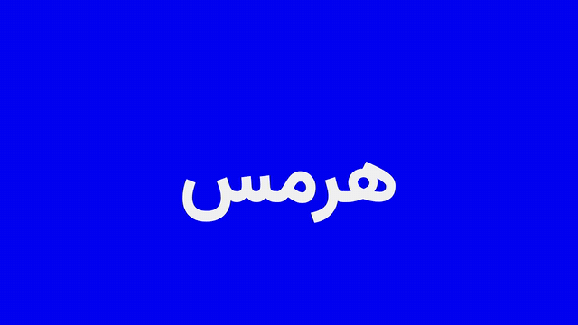

<div align="center">



# persian-motion-director

**A Claude skill for professional motion design with correct Persian typography.**<br>
Films that don't play like slideshows, and Persian that doesn't fall apart.

</div>

Most generated motion fails in two predictable ways. It plays like a slideshow: scenes fade into each other, one ease-in-out on everything, everything arrives at once. And its Persian breaks: letters split apart when animated, dots get clipped, Arabic letters and digits slip in, half-spaces go missing, reveals run the wrong way.

This skill teaches Claude to direct instead: show directions before building, lock the music first, cut on the beat, keep one camera moving, and set Persian the way a Persian reader expects. It comes with eight working techniques, tooling for per-letter and per-dot Persian animation, and a checklist and linter for Persian copy.

## Eight techniques

Every sketch is plain JavaScript, a pure function of time, so the same code runs live in a browser and frame-exact in [Remotion](https://www.remotion.dev).

| | |
|---|---|
| <br>**02 · One camera, no cuts** · یک دوربین، بدون کات<br>Scenes on one strip, right to left; whip pans with motion blur and parallax. | <br>**03 · One shape carries the story** · یک شکل، کلِ داستان<br>The full stop grows into the reply bubble, then into the next full stop. |
| <br>**04 · The real UI, directed** · رابطِ واقعی، کارگردانی‌شده<br>RTL interface in 3D, a cursor on arcs, a focus pull. | <br>**05 · Cut on the beat** · کات روی ضرب<br>Music first; a hard cut on every beat, punch-ins, inverted frames. |
| <br>**06 · On twos, with line boil** · دوفریمی، با خطِ لرزان<br>Drawings hold two frames, lines wobble; the camera stays smooth. | <br>**07 · Paper cut-out letters** · حروفِ کاغذی<br>Each joined letter group is a rigid paper piece, one light, matching shadows. |
| <br>**08 · Dots last** · نقطه‌ها آخر<br>Letter bodies first, right to left; then the dots drop in. | <br>**09 · Kashida, not letter-spacing** · کشیده، نه فاصله<br>Stretch the joining stroke, measured in calligraphic dots. |

The numbering follows the original direction board (01 and 10 were left out).

## What's inside

```
SKILL.md                      the director's loop, anti-slideshow rules, Persian non-negotiables
references/
  workflow.md                 brief → directions → music first → shot list on the bar grid → style frames → build → checks
  anti-slideshow.md           curves, springs, staggers, holds, motion blur, rhythm (with numbers and sources)
  persian-typography.md       joining, masks, bidi, characters, kashida, fonts, a review checklist
  persian-copy.md             natural Persian for motion, common machine-copy mistakes
  techniques/02…09            one file per technique: recipe, values, Persian notes, the X posts behind it
scripts/
  shape_persian.py            HarfBuzz shaping → SVG outlines split into letter bodies, dots and joined groups
  split_fa.js                 split a word into letters that keep their joined forms (zero-width joiners)
  lint_persian.py             lint copy (ي/ك, digits, half-spaces, punctuation, kashida) and code (letter boxes, letter-spacing, fades)
assets/
  sketches/                   motion engine, the eight sketches, shaped glyph data, gallery.html
  remotion/                   SketchPlayer adapter, one clip per technique, the intro film, render scripts
  music/compose_shur_pulse.py an original 120 BPM track in Dastgah Shur, written in code, with a beat map
```

## Install

Claude Code (personal skills):

```bash
git clone https://github.com/atmirrr/persian-motion-director ~/.claude/skills/persian-motion-director
```

Or put it in a project's `.claude/skills/` folder. Claude picks it up when you ask for motion with Persian or RTL text, or when you say an animation looks "like a slideshow".

## Use

Things to ask Claude:

- "Make a 30-second Persian teaser for my app in Remotion, cut to music."
- "This animation looks like a slideshow. Make it feel pro."
- "My Persian title breaks into separate letters when I animate it."
- "Show me 8 motion directions for our launch film before you build anything."

Check Persian copy and code yourself:

```bash
python3 scripts/lint_persian.py copy copy.txt
python3 scripts/lint_persian.py code src/
pip install uharfbuzz fonttools
python3 scripts/shape_persian.py assets/sketches/fonts/Vazirmatn-VF.ttf "کارگردان موشن فارسی" --wght 800
```

## Run the examples

Live sketches in a browser:

```bash
cd assets/sketches && python3 -m http.server 8000   # open http://localhost:8000/gallery.html
```

Render the clips and the intro film with Remotion:

```bash
cd assets/remotion
npm install
npx remotion studio src/index.ts          # browse every composition
node render-clips.mjs out                 # the eight technique clips
node render-clips.mjs out --only Intro    # the 82-second intro film
python3 ../music/compose_shur_pulse.py public/music   # rebuild the music (WAV) and beat map, then convert to MP3
```

The intro film is the worked example: music first (120 BPM, Shur on D), a bar map, every cut on a beat, one camera that whips right to left between sections, and Persian set correctly throughout. See `assets/remotion/src/intro/Intro.tsx`.

## Where the method comes from

The anti-slideshow rules and the eight techniques come from research into how professional motion designers describe their own work on X (October 2026, about 100 posts, each one checked to exist). Every technique file links the posts it draws on. The Persian rules follow W3C's [Arabic & Persian Layout Requirements](https://www.w3.org/TR/alreq/) and were tested in Chrome, the engine Remotion renders with.

<div dir="rtl" lang="fa">

## به فارسی

**کارگردانِ موشنِ فارسی** یک اسکیل متن‌باز برای Claude است که دو مشکل همیشگی موشن‌های ساخته‌شده با هوش مصنوعی را حل می‌کند: حسِ اسلایدشو، و فارسیِ به‌هم‌ریخته.

- اول جهت‌ها را نشان می‌دهد و بعد می‌سازد؛ اول موسیقی، بعد تدوین، و هر کات روی ضرب.
- یک دوربین که بین صحنه‌ها از راست به چپ حرکت می‌کند، به‌جای محو شدن صحنه‌ها در هم.
- حروف فارسی هیچ‌وقت از هم جدا نمی‌شوند؛ برای انیمیشنِ حرف‌به‌حرف و نقطه‌به‌نقطه، متن با HarfBuzz شکل‌دهی می‌شود.
- اعداد فارسی، «ی» و «ک» فارسی، نیم‌فاصله، علامت‌گذاری فارسی و جهت راست به چپ، همه با یک چک‌لیست و یک لینتر کنترل می‌شوند.
- به‌جای فاصله انداختن بین حروف، کشیده؛ همان‌جایی که خط اجازه می‌دهد.

</div>

## License

Code: MIT. Vazirmatn: SIL Open Font License (`assets/sketches/fonts/OFL.txt`). The music in `assets/remotion/public/music` is generated by `assets/music/compose_shur_pulse.py` and is free to use. Example copy uses the word هرمس (Hermes) from the original brief; the default palette (`#0000F2`, `#F2F2F2`, `#F2F200`) is set with CSS variables and easy to change.
